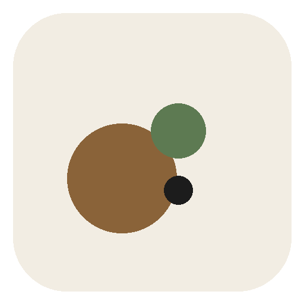
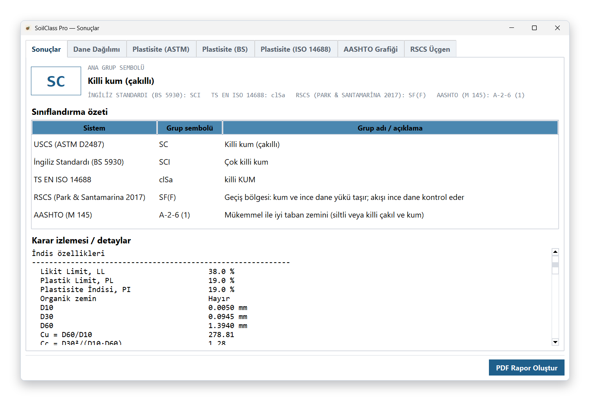
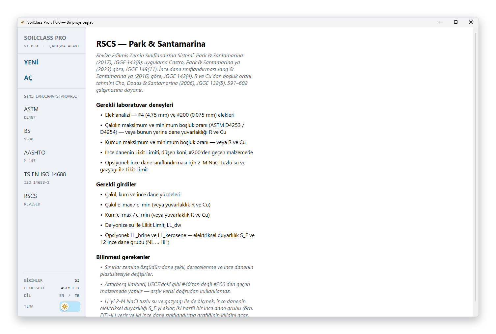
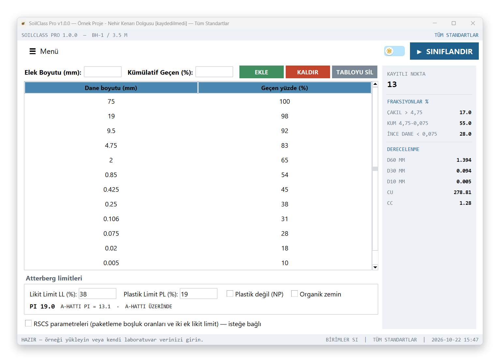
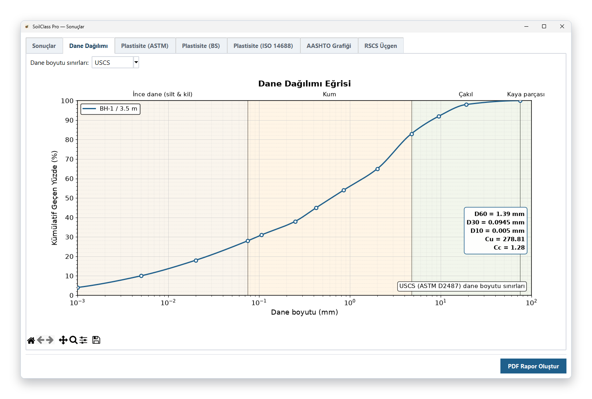
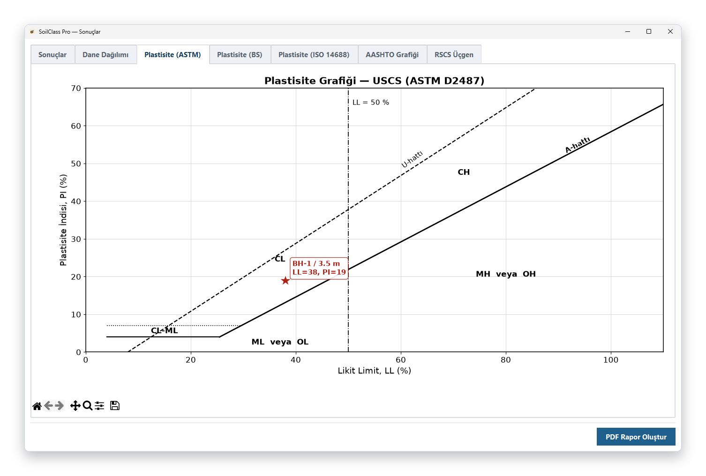
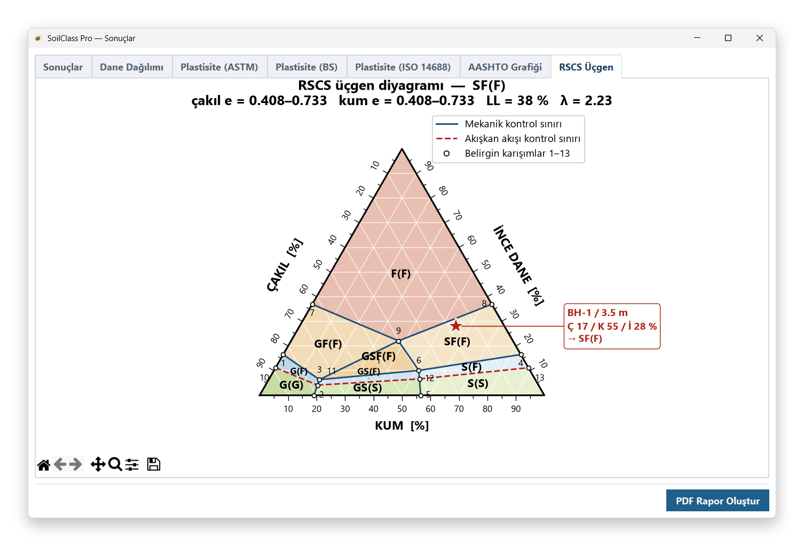
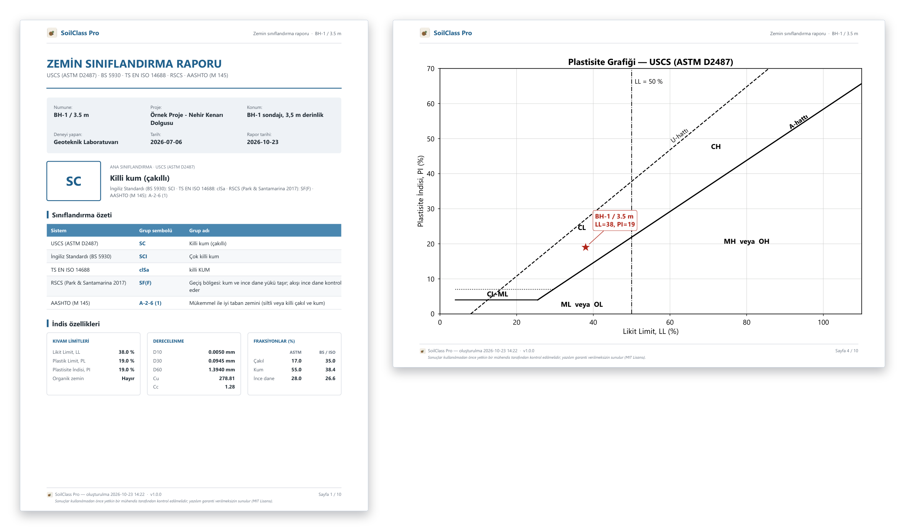
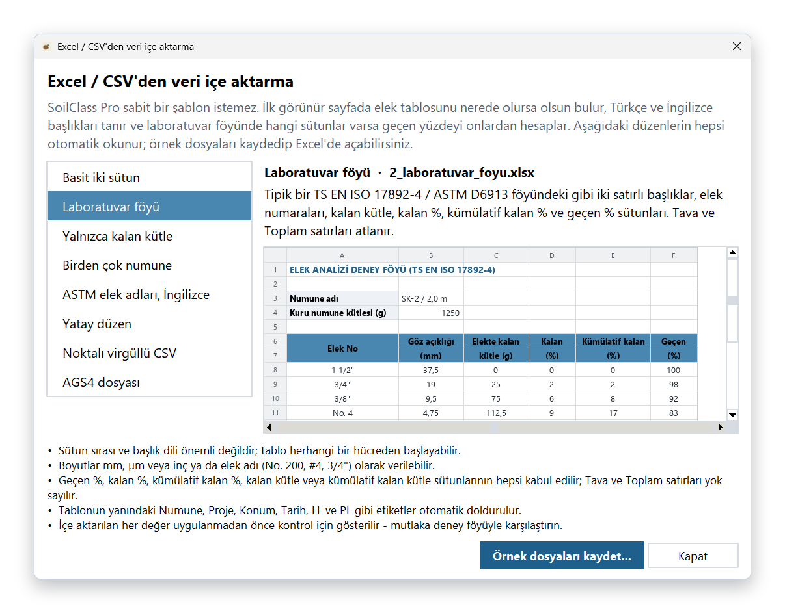

# SoilClass Pro

### Tek veri girişi, beş zemin sınıflandırma sistemi

USCS · BS 5930 · TS EN ISO 14688 · AASHTO · RSCS

 

&nbsp;

  

[Özellikler](#özellikler) · [Ekran görüntüleri](#ekran-görüntüleri) · [Kurulum](#kurulum) · [Gereksinimler](#sistem-gereksinimleri) · [Excel'den veri aktarma](#excel-ve-csvden-veri-aktarma) · [Geliştiriciler](#geliştiriciler) · [English](#english)

 

  

## Neden SoilClass Pro?

Aynı zemin numunesi farklı sınıflandırma sistemlerinde çoğu zaman farklı adlar alır: USCS'de *killi kum* olan bir zemin, AASHTO'da *A-2-6*, Revize Zemin Sınıflandırma Sistemi'nde (Park ve Santamarina, 2017) ise davranışı ince danelerin kontrol ettiği bir *geçiş zemini* olarak tanımlanabilir. Bu sistemleri elle ve tek tek uygulamak hem zaman alır hem de hataya açıktır.

**SoilClass Pro**, elek analizi ve kıvam limitlerinden oluşan **tek bir laboratuvar veri setiyle** zemini beş sisteme göre aynı anda sınıflandırır. Her sonucun hangi adımlardan geçilerek bulunduğunu gösterir, tüm grafikleri otomatik çizer ve sonuçları tek tıkla PDF rapora dönüştürür. Ücretsiz ve açık kaynaklıdır; Türkçe ve İngilizce kullanılabilir.

SoilClass Pro, ODTÜ İnşaat Mühendisliği Bölümü **Dr. Elif Oğuz CE STAR Lisans Araştırma Programı** kapsamında geliştirilmiştir.

## Özellikler

<table>
<tr>
<td width="50%" valign="top">

#### 🧭 Beş sistem, tek giriş
USCS, BS 5930, TS EN ISO 14688, AASHTO ve RSCS sonuçları yan yana ve karşılaştırmalı olarak gösterilir.

</td>
<td width="50%" valign="top">

#### 🔍 Şeffaf karar izlemesi
Her sınıflandırma adımı, kullanılan sınır değerler ve gerekçeleriyle birlikte satır satır açıklanır.

</td>
</tr>
<tr>
<td valign="top">

#### 📈 Otomatik grafikler
Dane dağılımı eğrisi (D10, D30, D60, Cu, Cc), üç standarda göre plastisite grafikleri, AASHTO LL–PI grafiği, RSCS üçgen diyagramı ve ince dane duyarlılık grafiği.

</td>
<td valign="top">

#### 📥 Esnek veri girişi
Elle giriş ya da Excel, CSV ve AGS4 dosyalarından içe aktarma. Sabit bir şablon gerekmez; farklı laboratuvar föyleri otomatik tanınır.

</td>
</tr>
<tr>
<td valign="top">

#### 📄 Rapor ve veri çıktısı
Grafikleri ve karar izlemesini içeren PDF rapor, standart AGS4 veri dosyası ve `.soilpro` proje dosyası.

</td>
<td valign="top">

#### 🌗 Modern arayüz
Türkçe ve İngilizce dil, açık ve koyu tema; her ekran çözünürlüğüne ve ölçeklendirme oranına uyum.

</td>
</tr>
</table>

## Ekran görüntüleri

<table>
<tr>
<td width="50%" align="center"> <b>Başlangıç ekranı:</b> standart seçimi ve deney gereksinimleri</td>
<td width="50%" align="center"> <b>Veri girişi:</b> elek analizi, kıvam limitleri ve anlık özet</td>
</tr>
<tr>
<td align="center"> <b>Dane dağılımı eğrisi</b> ve derecelenme parametreleri</td>
<td align="center"> <b>Plastisite grafiği:</b> USCS (ASTM D2487)</td>
</tr>
<tr>
<td align="center"> <b>RSCS üçgen diyagramı</b> (Park ve Santamarina, 2017)</td>
<td align="center"> <b>PDF rapor:</b> sonuçlar, grafikler ve karar izlemesi</td>
</tr>
</table>

## Desteklenen sistemler

| Sistem | Standart / kaynak |
|---|---|
| Birleştirilmiş Zemin Sınıflandırma Sistemi (USCS) | ASTM D2487 |
| İngiliz Standardı | BS 5930:2015+A1:2020 |
| Türk / Avrupa Standardı | TS EN ISO 14688-1 / -2:2018 |
| AASHTO | AASHTO M 145 / ASTM D3282 |
| Revize Zemin Sınıflandırma Sistemi (RSCS) | Park ve Santamarina (2017) |

## Kurulum

### Windows

1. [Son sürüm sayfasından](https://github.com/batuhanbarisdoger/SoilClassPro/releases/latest) `SoilClassPro_Setup_1.0.1.exe` dosyasını indirin.
2. Dosyayı çalıştırın ve kurulum adımlarını izleyin.
3. SoilClass Pro'yu Başlat menüsünden ya da masaüstü kısayolundan açın.

> **ℹ️ Not**
>
> Kurulum dosyası henüz dijital olarak imzalanmadığı için Windows SmartScreen *"Bilinmeyen yayımcı"* uyarısı gösterebilir. **Ek bilgi → Yine de çalıştır** ile devam edebilirsiniz. Yeni bir sürüm yayımlandığında program açılışta sizi bilgilendirir.

### macOS

1. [Son sürüm sayfasından](https://github.com/batuhanbarisdoger/SoilClassPro/releases/latest) `SoilClassPro-macOS-1.0.1.zip` dosyasını indirin ve açın.
2. `SoilClassPro.app` uygulamasını **Uygulamalar** klasörüne sürükleyin.
3. İlk açılışta *"geliştirici doğrulanamadı"* uyarısı çıkarsa **Sistem Ayarları → Gizlilik ve Güvenlik** bölümüne gidin, aşağı kaydırıp SoilClass Pro için **Yine de Aç** düğmesine basın.

> **ℹ️ Not**
>
> macOS sürümü Apple'ın kimlik doğrulaması olmadan dağıtılmaktadır; bu yüzden ilk açılışta Gatekeeper uyarısı görünebilir. Uygulama kendi kullanıcı hesabınıza kurulur ve yönetici yetkisi gerektirmez.

## Sistem gereksinimleri

| Gereksinim | Ayrıntı |
|---|---|
| **İşletim sistemi** | Windows 10 veya Windows 11, 64 bit (x64); veya macOS (Apple Silicon, M1 ve sonrası işlemciler) |
| **Bellek (RAM)** | 4 GB yeterlidir; program çalışırken yaklaşık 120–220 MB kullanır |
| **Disk alanı** | Yaklaşık 200 MB boş alan (kurulum ~50 MB, çalışırken geçici dosyalar ~90 MB) |
| **Ekran** | En az 1366 × 768 önerilir; %100–%200 ölçeklendirme ve yüksek çözünürlüklü ekranlar desteklenir |
| **Ek yazılım** | Gerekmez. Python, Microsoft Excel veya başka bir bileşen kurmanız gerekmez; raporları açmak için bir PDF görüntüleyici yeterlidir |
| **Yönetici yetkisi** | Gerekmez; kurulum yalnızca kendi kullanıcı hesabınıza yapılabilir |
| **İnternet** | Gerekmez; yalnızca açılışta yeni sürüm olup olmadığını kontrol etmek için kullanılır |

> **ℹ️ Not**
>
> Windows 7, 8 / 8.1 ve 32 bit Windows sürümleri desteklenmez. macOS sürümü Intel işlemcili Mac'lerde test edilmemiştir ve derlemesi yalnızca Apple Silicon için yapılmaktadır. Linux için şu an kurulum dosyası sunulmamaktadır.

## Excel ve CSV'den veri aktarma

Laboratuvarlar elek analizi sonuçlarını çok farklı düzenlerde tutar. SoilClass Pro bu nedenle **tek bir şablona bağlı değildir**: elek tablosunu sayfanın neresinde olursa olsun bulur, Türkçe ve İngilizce başlıkları tanır ve geçen yüzdeyi; geçen %, kalan %, kümülatif kalan % veya kalan kütle sütunlarından hangisi varsa ondan hesaplar. Numune adı, proje, tarih ve kıvam limitleri de otomatik okunur. Excel (`.xlsx`, `.xls`), CSV ve AGS4 dosyaları desteklenir.

  

Desteklenen sekiz düzen, indirilebilir örnek dosyalar ve tanınan başlıkların listesi için **[Excel / CSV'den veri içe aktarma](docs/veri-ice-aktarma.md)** sayfasına bakın. Aynı bilgiler program içinde **Menü → İçe Aktar → Desteklenen dosya biçimleri…** altında da bulunur.

## Sorumluluk reddi

> **⚠️ Uyarı**
>
> SoilClass Pro eğitim ve araştırma amaçlı, yardımcı bir araçtır. Sonuçlar yalnızca girilen verilere ve standartların yazılımdaki uygulanış biçimine dayanır. Sınıflandırma sonuçları, ilgili standartlara göre yetkin bir mühendis tarafından kontrol edilmeden tasarım, uygulama veya resmi raporlarda kullanılmamalıdır. Yazılım, MIT Lisansı kapsamında "olduğu gibi" ve hiçbir garanti verilmeksizin sunulur; geliştiriciler, yazılımın kullanımından ya da hatalı bir sınıflandırmadan doğabilecek doğrudan veya dolaylı hiçbir zarardan hukuken sorumlu tutulamaz.

## Atıf

Bu yazılımı akademik bir çalışmada kullanırsanız lütfen bildiriye atıf yapın:

> Döğer, B.B., Boz, E., Ekici, F.K. ve Huvaj, N. (2026), "Revize Zemin Sınıflandırma Sistemi (2017) ve Farklı Zemin Sınıflandırma Sistemleri İçin Bir Yazılım", *Zemin Mekaniği ve Geoteknik Mühendisliği 20. Ulusal Konferansı*, Sakarya Üniversitesi.

Sağ kenardaki **Cite this repository** bağlantısıyla APA ve BibTeX biçimlerinde atıf metni de alabilirsiniz.

## Geliştiriciler

<table>
<tr>
<td align="center" valign="top" width="280">
 
<b>Batuhan&nbsp;Barış&nbsp;Döğer</b> 
ODTÜ İnşaat Mühendisliği  

</td>
<td align="center" valign="top" width="280">
 
<b>Erol&nbsp;Boz</b> 
ODTÜ İnşaat Mühendisliği  

</td>
<td align="center" valign="top" width="280">
 
<b>Furkan&nbsp;Kağan&nbsp;Ekici</b> 
ODTÜ İnşaat Mühendisliği  

</td>
</tr>
</table>

Orta Doğu Teknik Üniversitesi (ODTÜ), İnşaat Mühendisliği Bölümü, Ankara Dr. Elif Oğuz CE STAR Lisans Araştırma Programı

<i>Rehberliği ve desteği için Nejan Huvaj hocamıza teşekkür ederiz.</i>

Bu çalışmanın yürütüldüğü lisans araştırma programına adını veren, 4 Ekim 2025'te kaybettiğimiz değerli hocamız <b>Doç. Dr. Elif Oğuz</b>'u saygı ve sevgiyle anıyoruz.

Hata bildirimi ve önerileriniz için [Issues](https://github.com/batuhanbarisdoger/SoilClassPro/issues) sayfasını kullanabilirsiniz.

## Lisans

SoilClass Pro [MIT Lisansı](LICENSE) ile dağıtılır. Kaynak kodu serbestçe kullanabilir, değiştirebilir ve paylaşabilirsiniz.

<b>Kaynaklar</b>

 

- ASTM D2487-17, *Standard Practice for Classification of Soils for Engineering Purposes (Unified Soil Classification System)*.
- BS 5930:2015+A1:2020, *Code of Practice for Ground Investigations*.
- EN ISO 14688-1 / -2:2018; TS EN ISO 14688-1 / -2, *Jeoteknik araştırma ve deneyler - Zeminlerin tanımlanması ve sınıflandırılması*.
- AASHTO M 145, *Standard Specification for Classification of Soils and Soil-Aggregate Mixtures for Highway Construction Purposes*.
- Park, J. ve Santamarina, J.C. (2017), "Revised Soil Classification System for Coarse-Fine Mixtures", *J. Geotech. Geoenviron. Eng.*, 143(8), 04017039.
- Castro, G.M., Park, J. ve Santamarina, J.C. (2023), "Revised Soil Classification System: Implementation and Engineering Implications", *J. Geotech. Geoenviron. Eng.*, 149(11), 04023109.
- Jang, J. ve Santamarina, J.C. (2016), "Fines Classification Based on Sensitivity to Pore-Fluid Chemistry", *J. Geotech. Geoenviron. Eng.*, 142(4), 06015018.
- Kovačević, M.S., Jurić-Kaćunić, D., Librić, L. ve Ivoš, G. (2018), "Engineering soil classification according to EN ISO 14688-2:2018", *Građevinar*.

---

## English

**SoilClass Pro** is a free, open-source Windows and macOS application that classifies a soil from a single set of laboratory data (sieve analysis and Atterberg limits) according to **USCS (ASTM D2487)**, **BS 5930**, **TS EN ISO 14688**, **AASHTO M 145** and the **Revised Soil Classification System (RSCS, Park & Santamarina 2017)** at the same time.

- **Five systems, one input:** results side by side, with a decision trail that justifies every step.
- **Charts:** grain-size distribution, plasticity charts for three standards, AASHTO LL–PI chart, RSCS triangle and fines sensitivity chart.
- **Flexible import:** manual entry, or Excel / CSV / AGS4 files in almost any lab-sheet layout, with no fixed template. See [the import guide](docs/veri-ice-aktarma.md#english).
- **Output:** PDF report, standard AGS4 data file and `.soilpro` project file.
- Turkish and English interface, light and dark themes, adapts to any screen resolution and scaling.

**Download:** get `SoilClassPro_Setup_1.0.1.exe` (Windows) or `SoilClassPro-macOS-1.0.1.zip` (macOS) from the [releases page](https://github.com/batuhanbarisdoger/SoilClassPro/releases/latest). The installer is not code-signed yet, so Windows may show an "unknown publisher" warning; choose **More info → Run anyway**. On macOS, unzip the file, drag `SoilClassPro.app` to Applications and, if Gatekeeper blocks the first launch, open **System Settings → Privacy & Security** and click **Open Anyway**. The program tells you when a new version is available.

**System requirements:** 64-bit Windows 10 or 11, or macOS on Apple Silicon (M1 and later); 4 GB RAM is plenty (the program uses about 120–220 MB); about 200 MB of free disk space; a 1366 × 768 or larger screen, with 100–200 % display scaling supported. No Python, Excel, administrator rights or internet connection are required (the internet is only used to check for new versions).

**Disclaimer:** SoilClass Pro is an auxiliary tool for education and research. Results depend solely on the data entered and on how the standards are implemented. Do not use them in design, construction or official reports without checking by a qualified engineer against the governing standards. The software is provided "as is" under the MIT License, without warranty of any kind; the developers accept no legal liability for any damage arising from its use or from an incorrect classification.

**Developers:** Batuhan Barış Döğer, Erol Boz and Furkan Kağan Ekici, Middle East Technical University (METU), Department of Civil Engineering, developed within the Dr. Elif Oğuz CE STAR Undergraduate Research Program. With special thanks to Nejan Huvaj for the guidance and support. We remember with deep respect and affection Assoc. Prof. Dr. Elif Oğuz, whom we lost on 4 October 2025 and whose name the research program bears.

**License:** [MIT](LICENSE)
