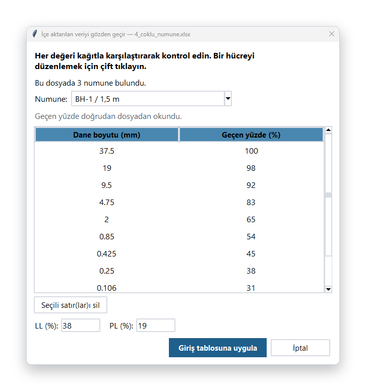
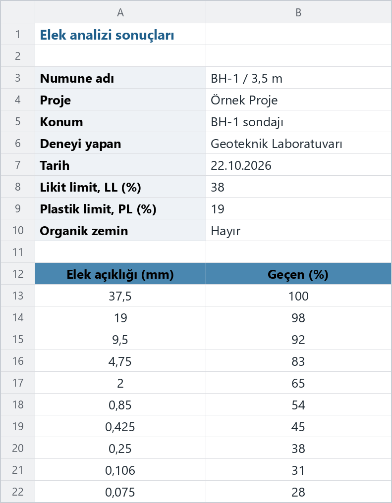
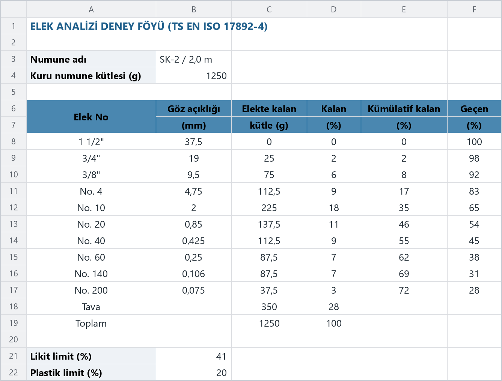
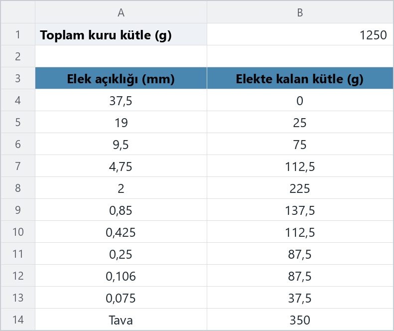
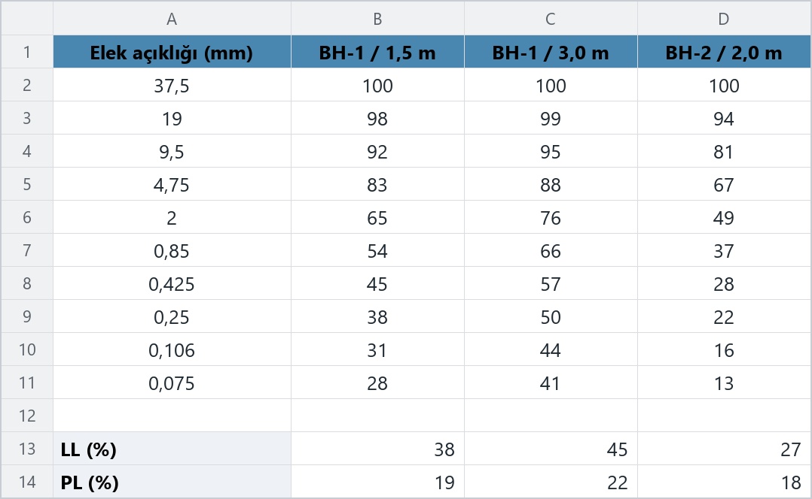
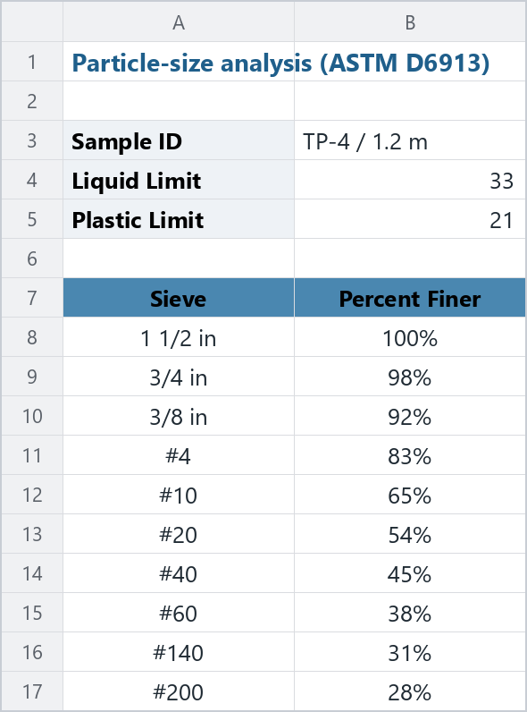
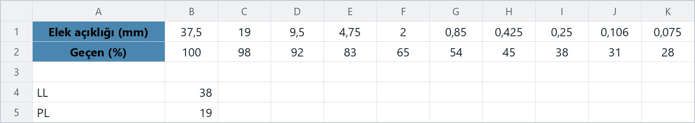
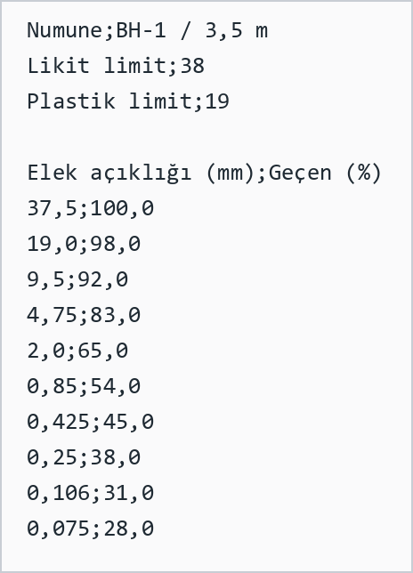
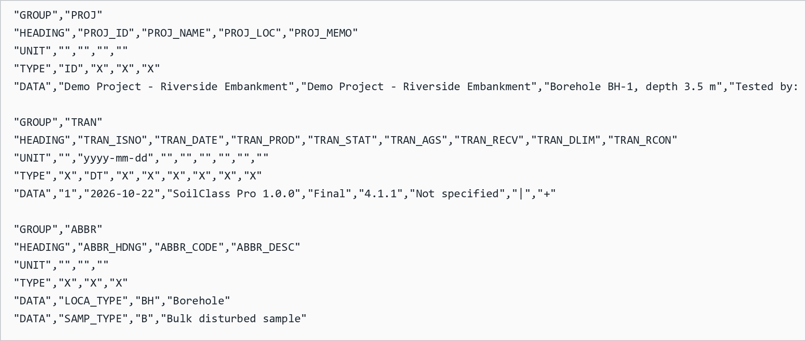

# Excel / CSV'den veri içe aktarma

**Sabit şablon yok: laboratuvar föyünüzü olduğu gibi açın.**

[← Ana sayfa](../README.md) · [English](#english)

---

SoilClass Pro, elek analizi verisini hazırladığınız dosyanın düzenine uymaya çalışır; sizin programa uymanız gerekmez. İlk görünür çalışma sayfasında elek tablosunu nerede olursa olsun bulur, Türkçe ve İngilizce başlıkları tanır ve föyde hangi sütunlar varsa **geçen yüzdeyi** onlardan hesaplar. Tablonun yanındaki numune adı, proje, konum, tarih ve kıvam limitleri de otomatik olarak doldurulur.

**Desteklenen dosyalar:** Excel (`.xlsx`, `.xlsm`, `.xls`), CSV / metin (`.csv`, `.txt`, `.tsv`) ve AGS4 (`.ags`).

## Nasıl içe aktarılır?

1. **Menü → İçe Aktar → CSV / Excel'den…** seçeneğini açın ve dosyanızı seçin.
2. Okunan değerler, uygulanmadan önce bir **kontrol penceresinde** gösterilir. Dosyada birden çok numune varsa listeden istediğinizi seçin; hatalı bir hücreyi çift tıklayarak düzeltebilir, gereksiz satırları silebilirsiniz.
3. **Giriş tablosuna uygula** ile veriler giriş ekranına aktarılır.

  

> **❗ Önemli**
>
> İçe aktarılan her değeri uygulamadan önce deney föyüyle karşılaştırın. Program, geçen yüzdenin elek boyutu küçüldükçe artması ya da PL > LL olması gibi şüpheli durumlarda uyarı verir.

Uygulama içinde de aynı bilgilere **Menü → İçe Aktar → Desteklenen dosya biçimleri…** üzerinden ulaşabilir, örnek dosyaları **Örnek dosyaları kaydet…** ile bilgisayarınıza kopyalayabilirsiniz.

  

## Desteklenen düzenler

Aşağıdaki örneklerin hepsi otomatik olarak okunur. Her birini indirip kendi verinizle doldurabilir ya da yalnızca kendi föyünüzün tanınıp tanınmayacağını görmek için inceleyebilirsiniz.

### 1. Basit iki sütun

Elek açıklığı (mm) ve geçen yüzde sütunları. Tablonun üstündeki etiket-değer çiftleri (numune adı, proje, konum, tarih, LL, PL) de okunur.

[⬇ 1_basit_iki_sutun.xlsx](../soilclass/assets/examples/1_basit_iki_sutun.xlsx?raw=1)

### 2. Laboratuvar föyü

Tipik bir TS EN ISO 17892-4 / ASTM D6913 föyündeki gibi iki satırlı başlıklar, elek numaraları, kalan kütle, kalan %, kümülatif kalan % ve geçen % sütunları. Tava ve Toplam satırları atlanır. Geçen % sütunu olmasa bile diğer sütunlardan hesaplanır.

[⬇ 2_laboratuvar_foyu.xlsx](../soilclass/assets/examples/2_laboratuvar_foyu.xlsx?raw=1)

### 3. Yalnızca kalan kütle

Sadece her elekte kalan kütle verildiğinde geçen yüzde toplam kuru kütleden hesaplanır. Toplam kütle yazılmamışsa kalan kütleler ve tava toplanır.

[⬇ 3_sadece_kalan_kutle.xlsx](../soilclass/assets/examples/3_sadece_kalan_kutle.xlsx?raw=1)

### 4. Birden çok numune

Ortak bir elek sütununun yanında her numune için ayrı bir sütun. İçe aktarırken yüklenecek numune listeden seçilir; tablonun altındaki LL ve PL satırları ilgili numuneye eşlenir.

[⬇ 4_coklu_numune.xlsx](../soilclass/assets/examples/4_coklu_numune.xlsx?raw=1)

### 5. ASTM elek adları, İngilizce başlıklar

Göz açıklığı yerine elek adları (`#4`, `#200`, `3/4 in`) ve *Percent Finer* gibi İngilizce başlıklar. Yüzde biçimli hücreler (%98) de tanınır.

[⬇ 5_astm_elek_numarasi_en.xlsx](../soilclass/assets/examples/5_astm_elek_numarasi_en.xlsx?raw=1)

### 6. Yatay düzen

Elek açıklıkları bir satırda, geçen yüzdeler hemen alt satırda.

[⬇ 6_yatay_duzen.xlsx](../soilclass/assets/examples/6_yatay_duzen.xlsx?raw=1)

### 7. Noktalı virgüllü CSV

Türkçe Excel'in noktalı virgül ayraçlı ve virgül ondalıklı kaydettiği CSV dosyaları. Virgül ve sekme ayraçlı dosyalar ile Windows-1254 (Türkçe) kodlaması da desteklenir.

[⬇ 7_noktali_virgul.csv](../soilclass/assets/examples/7_noktali_virgul.csv?raw=1)

### 8. AGS4 dosyası

AGS4 veri aktarım dosyaları: tane dağılımı (`GRAT` / `GRAD`) ve kıvam limitleri (`LLPL`) grupları. Dosyadaki her numune ayrı ayrı seçilebilir. SoilClass Pro'nun dışa aktardığı AGS4 dosyaları da bu şekilde geri yüklenebilir.

[⬇ 8_ags4_ornek.ags](../soilclass/assets/examples/8_ags4_ornek.ags?raw=1)

## Tanınan başlıklar ve birimler

Sütun sırası ve büyük/küçük harf önemli değildir. Başlıklarda aşağıdaki ifadelerden biri geçmesi yeterlidir.

| Veri | Türkçe örnekler | İngilizce örnekler |
|---|---|---|
| Elek açıklığı | Elek açıklığı, Göz açıklığı, Dane boyutu, Elek çapı | Sieve size, Opening, Aperture, Particle size, Grain size |
| Elek adı | Elek No, Elek numarası | Sieve No, Designation, # |
| Geçen yüzde | Geçen (%), Geçen yüzde | Passing (%), Percent finer |
| Kalan yüzde | Kalan (%) | Retained (%) |
| Kümülatif kalan yüzde | Kümülatif kalan (%), Birikimli kalan | Cumulative retained (%) |
| Kalan kütle | Elekte kalan kütle (g), Ağırlık | Mass retained (g), Weight |
| Toplam kütle | Toplam / kuru numune kütlesi | Total / initial dry mass |
| Kıvam limitleri | Likit limit, Plastik limit, LL, PL, wL, wP | Liquid limit, Plastic limit |
| Numune bilgileri | Numune adı, Proje, Konum, Sondaj, Deneyi yapan, Tarih | Sample ID, Project, Location, Borehole, Tested by, Date |

- **Birimler:** mm (varsayılan), µm ve inç. Başlıkta `(µm)` veya `(in)` yazıyorsa değerler otomatik olarak mm'ye çevrilir.
- **Elek adları:** `No. 200`, `#4`, `3/4"`, `1 1/2 in` gibi ASTM adları göz açıklığına çevrilir.
- **Ondalık ayırıcı:** hem virgül (`0,075`) hem nokta (`0.075`) kabul edilir.
- **Yüzdeler:** `98`, `%98` veya `0,98` (Excel'de yüzde biçimli hücre) olarak yazılabilir.
- **Tava / Toplam satırları** elek noktası olarak alınmaz; tava kütlesi gerekiyorsa hesapta kullanılır.
- **RSCS parametreleri** (çakıl ve kum için emaks / emin, tuzlu su ve gazyağı ile likit limit) tablonun yanında etiketleriyle verilirse onlar da okunur ve RSCS sınıflandırması otomatik olarak dahil edilir.

## Dosyam okunmadı, ne yapmalıyım?

- Verinin dosyadaki **ilk görünür sayfada** olduğundan emin olun.
- Başlık satırında elek boyutu ile geçen / kalan bilgisini gösteren bir ifade bulunsun (yukarıdaki tabloya bakın).
- Birleştirilmiş hücreler, boş satırlar ve açıklama satırları sorun değildir; ancak elek tablosunun satırları arasında başka bir tablo olmamalıdır.
- `.ods` veya `.numbers` gibi biçimleri önce Excel (`.xlsx`) ya da CSV olarak kaydedin.
- Hâlâ sorun yaşıyorsanız dosyanızı (kişisel bilgileri çıkararak) [Issues](https://github.com/batuhanbarisdoger/SoilClassPro/issues) sayfasında paylaşın; düzeninizi desteklemeye çalışalım.

---

## English

SoilClass Pro does not require a fixed template. It looks for the sieve table anywhere in the first visible sheet, recognises Turkish and English headings and works out percent passing from whichever columns your lab sheet contains (percent passing, % retained, cumulative % retained, mass retained or cumulative mass retained). Sample name, project, location, date and Atterberg limits next to the table are filled in automatically.

Supported files: Excel (`.xlsx`, `.xlsm`, `.xls`), CSV / text (`.csv`, `.txt`, `.tsv`) and AGS4 (`.ags`). Use **Menu → Import → From CSV / Excel…**; every value is shown for review before it is applied. The eight example files above cover simple two-column tables, full laboratory sheets with two-row headings, mass-only data, several samples per sheet, ASTM sieve names with English headings, horizontal layouts, semicolon-separated CSV and AGS4. They can also be saved from inside the program via **Menu → Import → Save example files…**.
